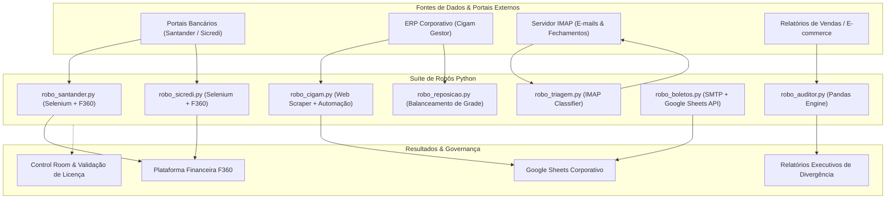

# 🤖 Suíte de Automações RPA & Engenharia de Dados Corporativos

[](https://www.python.org/)
[](https://www.selenium.dev/)
[](https://pandas.pydata.org/)
[](#-arquitetura-da-solu%C3%A7%C3%A3o)
[](#-seguran%C3%A7a-governan%C3%A7a-e-compliance)

Este repositório reúne um conjunto de robôs de automação de processos de negócios (**Robotic Process Automation - RPA**) e motores de conciliação financeira desenvolvidos para eliminar gargalos manuais, auditar transações e integrar sistemas legados (ERPs, portais bancários e e-commerce) a matrizes analíticas de liderança.

---

## 📈 Impacto de Negócio & Métricas de Eficiência

| Frente de Automação | Tempo Manual Anterior | Tempo com RPA | Redução de Esforço |
| :--- | :---: | :---: | :---: |
| **Conciliação Bancária & F360** (Santander/Sicredi) | ~3h / dia | ~4 min | **-97%** |
| **Auditoria Cruzada E-commerce & Repasses** | ~4h / fechamento | ~30 seg | **-99%** |
| **Triagem & Movimentação de Fechamento de Caixa** | ~1h / dia | ~1 min | **-98%** |
| **Geração de Reposição de Estoque Multi-Lojas** | ~5h / semana | ~3 min | **-98%** |
| **Disparo de Boletos com Multi-Anexos** | ~2h / ciclo | ~2 min | **-98%** |

---

## 🏗️ Arquitetura da Solução



---

## 📁 Estrutura Modular dos Projetos

```text
automacoes/
├── conciliacao_santander/   # Automação de extrato e conciliação Santander -> F360
├── conciliacao_sicredi/     # Download de comprovantes e conciliação Sicredi -> F360
├── auditoria_ecommerce/      # Cruzamento em lote de pedidos, faturas e repasses com Pandas
├── triagem_email/           # Classificação inteligente de e-mails de caixa via IMAP
├── erp_cigam/               # Extração de relatórios e movimentação automatizada no ERP Cigam
├── disparo_boletos/         # Disparo automático de boletos com anexos e Google Sheets API
└── reposicao_estoque/       # Motor matemático de cálculo de reposição e balanceamento entre lojas
```

---

## 🛠️ Tecnologias Utilizadas

- **Linguagem Principal:** Python 3.10+
- **Navegação & Web Scraping:** Selenium WebDriver, Webdriver Manager
- **Tratamento & Análise de Dados:** Pandas, OpenPyXL, Xlwings
- **Integração em Nuvem:** Google Sheets API (`gspread`, `oauth2client`, `google-auth`)
- **Protocolos de Comunicação:** IMAP (SSL), SMTP (TLS), REST APIs
- **Segurança:** `python-dotenv` para isolamento rigoroso de variáveis de ambiente

---

## 🔒 Segurança, Governança e Compliance (LGPD)

- **Isolamento de Credenciais:** Nenhum dado confidencial, usuário, senha ou token corporativo reside no repositório. Todas as chaves são lidas de variáveis de ambiente (`.env`).
- **Anonimização de Dados:** Os scripts utilizam moldes e variáveis parametrizadas para lojas, contas bancárias e documentos, garantindo total conformidade com a LGPD e sigilo empresarial.
- **GitIgnore Blindado:** Bloqueio permanente de extensões sensíveis (`.env`, `.json`, `.xlsm`, `.xlsx`, `.csv`, `.pdf`, `.log`, `.exe`).
- **Gestão de Falhas:** Tratamento de exceções com logs estruturados e retentativas automáticas em operações de rede e timeouts de elementos HTML dinâmicos.

---

## 🚀 Como Executar Localmente

### 1. Clonar o repositório
```bash
git clone https://github.com/iaralara/robos-validados.git
cd robos-validados
```

### 2. Criar e ativar o ambiente virtual
```bash
# Windows
python -m venv venv
.\venv\Scripts\activate

# Linux / Mac
python3 -m venv venv
source venv/bin/activate
```

### 3. Instalar as dependências
```bash
pip install -r requirements.txt
```

### 4. Configurar as variáveis de ambiente
Copie o modelo de ambiente e preencha as variáveis locais:
```bash
cp .env.example .env
```

---

## 👩‍💻 Autoria & Contato

Desenvolvido por **Iara Lara**  
- **GitHub:** [@iaralara](https://github.com/iaralara)  
- **Foco de Atuação:** Engenharia de Automação RPA, Desenvolvimento Fullstack e Inteligência Financeira  
